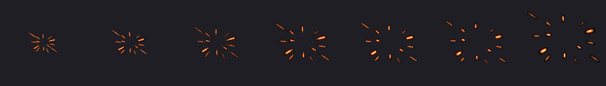
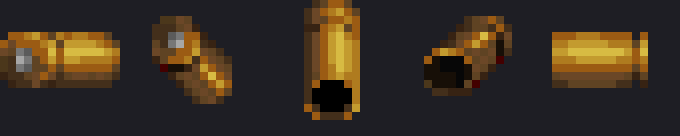
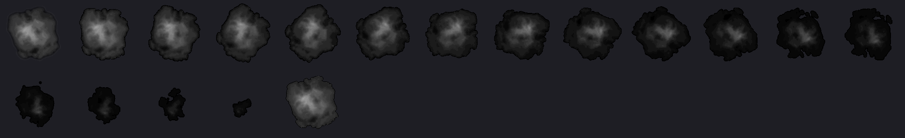

# RS_Ballistics

**The combat-effects generator for the UZDXREMA (DoomXR) mod family.**

A gun does not describe its own effects here. It names profiles on its sheet —
`flashprofile`, `recoilprofile`, `roundprofile`, `ejectaprofile` — and this
package turns those names into what the shot looks like, sounds like, and does
to the wall behind it. **1251 profiles cover every gun in every set.**

Two things it refuses to do the easy way:

- **Recoil is computed, never typed.** Bullet weight, muzzle velocity, powder
  charge and the loaded gun's weight go through free-recoil arithmetic. An MG42
  and a Kar98k fire the same cartridge out of a 25 lb gun and a 9 lb gun, and
  the numbers say so: identical impulse, three times apart in energy.
- **Nothing here moves the camera.** In VR the camera is the player's head, so
  a jolt we compute fights their inner ear. Recoil is torque spent on the thing
  you look *at*, never the thing you look *through*.

Everything below is the full inventory. Data in lumps turns into:
- real rounds in flight as **3D models** -- one mesh at eight sizes, so a buckshot pellet is a stub and a
  .30-06 tracer is a long fat streak, each round turning to face its own flight -- with vapour trails, heat
  shimmer, flight lights and near-miss whiz and crack
- muzzle flashes (every shot its own: sparks lean, spread and burn differently, powder burns redder or whiter), gunsmoke
  and a smoking, glowing barrel; point-blank powder burns, dust kicked off nearby walls, a shockwave of bent air, and
  gunshot tails
- spent casings and hulls, and chainsaw engine exhaust
- impacts by surface material: sparks, 3D chunks, dust, splinters, glints, splashes,
  marks and ricochets -- each round type with its own hit character; tech panels short out in arcs,
  screens crack and arc, lights pop, pipes vent steam, brick, marble and tile break into their own pieces
- room-filling smoke the guns, blasts, flames and rockets fill and the rounds tear; rockets and flames leave black soot (engine smoke volume)
- debris that bounces, collides with the whole level, patters as it lands and stays for the fight (engine collision and debris pool)
- lasting wall damage: bullet holes by material, gouges, craters, scorch rings, chainsaw cuts and flamethrower soot
  (engine surface damage)
- light from sparks, embers and tracers, and muzzle flashes that can throw shadows (engine effect lights)
- volumetric flashes and blasts: every gun's flash and every rocket, plasma and BFG blast as real glowing gas with depth
  that lights the haze, each gun its own shape (engine emissive volumes; the flat flame card and cone are the fallback)
- flamethrowers: a licking drawn-line core, flame that slides along what it hits,
  scorch and black smoke
- looks for plasma, rockets, the BFG, the railgun and the chainsaw
- enemy fire: monsters' hitscans fly as real rounds with our tracers, cracks and hits, or stay instant and are
  dressed in our looks; far fights draw lighter
- **recoil computed from real physics, not typed**: every gun's kick comes from bullet weight, muzzle
  velocity, powder charge and the loaded gun's weight, through free-recoil arithmetic. An MG42 and a Kar98k
  fire the same cartridge out of a 25 lb gun and a 9 lb gun and the file says so -- identical impulse,
  three times apart in energy. Guns with no cartridge (a BFG, a chainsaw, a spray can) state a kick instead,
  and stating it is a decision rather than an omission
- **fire that rides what it was set alight on**: a burning man burns while he runs and carries his own
  light with him, rather than leaving a scorch mark where he was standing
- **cold**, which is not warm fire: frost vapour that SINKS, ice that falls rather than burning out, a pale
  mark, and the one impact in the package that bends no air because there is no heat to shimmer
- **a jet that is not fire at all**: an inert aerosol -- no light, no heat, no scorch, no sound -- and the
  same jet ignited when something lights it
- three server rules: gameplay recoil for the guns that use it, whether our rounds also leave vanilla decals, and
  enemy hitscans as rounds

The same system covers everything from no effects at all to EXTREME, in VR. The
effects level (off, plain, normal, heavy, extreme) scales counts, lights, sizes,
smoke, shoves, shimmer, mark life, glow and tracers; `@extreme` profiles add what
only the top level shows. Effects are picked per player by level, style and menu
settings.

## What it draws

Sparks thrown off a hard surface, expanding and cooling (`RSSP`):

A spent case tumbling (`RSCS`) — the 9mm, .45, .357 and 12-gauge are generated
by `tools/gen_casings.py` and owned outright:

An electric arc, for tech panels and screens shorting out (`RSEC`):

Dust and smoke rolling off a hit and thinning out, 18 frames, greyscale so it
can be tinted to whatever material was struck (`RSDS`):

These are sprites only. The rounds in flight are 3D models, the flashes and
blasts are emissive volumes, and the smoke is an engine volume -- none of that
photographs. `python tools/make_docs_sheets.py` regenerates these; `docs/` is
deliberately outside the build's allowlist, so nothing in it becomes a lump.

1251 profiles.
